# Poly Haven: Nature models

**31 assets from [Poly Haven](https://polyhaven.com), dedicated to the public domain under [CC0](https://polyhaven.com/license).** Use them in any game, free or paid, and change them however you like; no credit is needed.

3D models as glTF at 1K and 2K texture resolution, each folder self-contained (`.gltf`, `.bin`, `textures/`). 1.2 GB in all.

This is a copy kept by [zuujis-cc0](https://github.com/zuujis-cc0) so game makers can take single files from GitHub. It is not made by or affiliated with Poly Haven: the originals, often in more formats and higher resolutions, are on [polyhaven.com](https://polyhaven.com). If they help you, consider [supporting Poly Haven](https://www.patreon.com/polyhaven/overview).

Every file is listed in [MANIFEST.tsv](MANIFEST.tsv) with its size and SHA-256. More free assets: [the Zuujis collection](https://github.com/zuujis-cc0/free-game-assets#readme).

| | | | |
| :-: | :-: | :-: | :-: |
| <a href="anthurium_botany_01">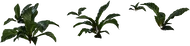</a> <b><a href="anthurium_botany_01">Anthurium Botany 01</a></b> by Rico Cilliers, Rob Tuytel · <a href="https://polyhaven.com/a/anthurium_botany_01">source</a> | <a href="bark_debris_01">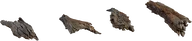</a> <b><a href="bark_debris_01">Bark Debris 01</a></b> by Greg Zaal, Jenelle van Heerden · <a href="https://polyhaven.com/a/bark_debris_01">source</a> | <a href="boulder_01">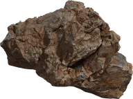</a> <b><a href="boulder_01">Boulder 01</a></b> by Rico Cilliers · <a href="https://polyhaven.com/a/boulder_01">source</a> | <a href="calathea_orbifolia_01">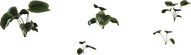</a> <b><a href="calathea_orbifolia_01">Calathea Orbifolia 01</a></b> by Rico Cilliers, Rob Tuytel · <a href="https://polyhaven.com/a/calathea_orbifolia_01">source</a> |
| <a href="celandine_01">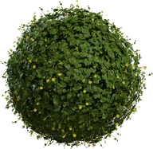</a> <b><a href="celandine_01">Celandine 01</a></b> by Rico Cilliers, Rob Tuytel · <a href="https://polyhaven.com/a/celandine_01">source</a> | <a href="cheiridopsis_succulent">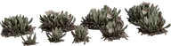</a> <b><a href="cheiridopsis_succulent">Cheiridopsis Succulent</a></b> by James Ray Cock, Jenelle van Heerden · <a href="https://polyhaven.com/a/cheiridopsis_succulent">source</a> | <a href="coast_land_rocks_02">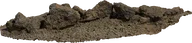</a> <b><a href="coast_land_rocks_02">Coast Land Rocks 02</a></b> by Rico Cilliers, Rob Tuytel · <a href="https://polyhaven.com/a/coast_land_rocks_02">source</a> | <a href="coast_land_rocks_03">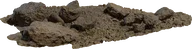</a> <b><a href="coast_land_rocks_03">Coast Land Rocks 03</a></b> by Rico Cilliers, Rob Tuytel · <a href="https://polyhaven.com/a/coast_land_rocks_03">source</a> |
| <a href="coast_land_rocks_04">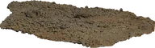</a> <b><a href="coast_land_rocks_04">Coast Land Rocks 04</a></b> by Rico Cilliers, Rob Tuytel · <a href="https://polyhaven.com/a/coast_land_rocks_04">source</a> |  <b><a href="coast_line_01">Coast Line 01</a></b> by Rico Cilliers, Rob Tuytel · <a href="https://polyhaven.com/a/coast_line_01">source</a> | <a href="coast_line_02">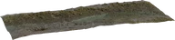</a> <b><a href="coast_line_02">Coast Line 02</a></b> by Rico Cilliers, Rob Tuytel · <a href="https://polyhaven.com/a/coast_line_02">source</a> | <a href="coast_rocks_01">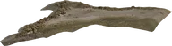</a> <b><a href="coast_rocks_01">Coast Rocks 01</a></b> by Rico Cilliers, Rob Tuytel · <a href="https://polyhaven.com/a/coast_rocks_01">source</a> |
| <a href="coast_rocks_02">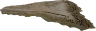</a> <b><a href="coast_rocks_02">Coast Rocks 02</a></b> by Rico Cilliers, Rob Tuytel · <a href="https://polyhaven.com/a/coast_rocks_02">source</a> | <a href="coast_rocks_03">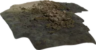</a> <b><a href="coast_rocks_03">Coast Rocks 03</a></b> by Rico Cilliers, Rob Tuytel · <a href="https://polyhaven.com/a/coast_rocks_03">source</a> | <a href="coast_rocks_05">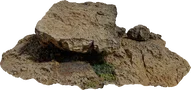</a> <b><a href="coast_rocks_05">Coast Rocks 05</a></b> by Rob Tuytel · <a href="https://polyhaven.com/a/coast_rocks_05">source</a> | <a href="coastal_cliff_01">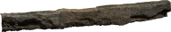</a> <b><a href="coastal_cliff_01">Coastal Cliff 01</a></b> by Rico Cilliers, Rob Tuytel · <a href="https://polyhaven.com/a/coastal_cliff_01">source</a> |
| <a href="coastal_cliff_02">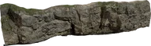</a> <b><a href="coastal_cliff_02">Coastal Cliff 02</a></b> by Rob Tuytel · <a href="https://polyhaven.com/a/coastal_cliff_02">source</a> | <a href="coastal_cliff_04">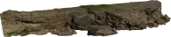</a> <b><a href="coastal_cliff_04">Coastal Cliff 04</a></b> by Rico Cilliers, Rob Tuytel · <a href="https://polyhaven.com/a/coastal_cliff_04">source</a> | <a href="crystalline_iceplant">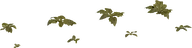</a> <b><a href="crystalline_iceplant">Crystalline Iceplant</a></b> by James Ray Cock, Jenelle van Heerden · <a href="https://polyhaven.com/a/crystalline_iceplant">source</a> | <a href="dandelion_01">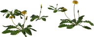</a> <b><a href="dandelion_01">Dandelion 01</a></b> by Rico Cilliers, Rob Tuytel · <a href="https://polyhaven.com/a/dandelion_01">source</a> |
|  <b><a href="dead_quiver_branch_01">Dead Quiver Branch 01</a></b> by Greg Zaal, Jenelle van Heerden · <a href="https://polyhaven.com/a/dead_quiver_branch_01">source</a> |  <b><a href="dead_quiver_branch_02">Dead Quiver Branch 02</a></b> by Greg Zaal, Jenelle van Heerden · <a href="https://polyhaven.com/a/dead_quiver_branch_02">source</a> |  <b><a href="dead_quiver_trunk">Dead Quiver Trunk</a></b> by Dario Barresi, James Ray Cock, Rico Cilliers · <a href="https://polyhaven.com/a/dead_quiver_trunk">source</a> |  <b><a href="dead_tree_trunk">Dead Tree Trunk</a></b> by Rob Tuytel · <a href="https://polyhaven.com/a/dead_tree_trunk">source</a> |
| <a href="dead_tree_trunk_02">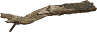</a> <b><a href="dead_tree_trunk_02">Dead Tree Trunk 02</a></b> by Jenelle van Heerden, Rico Cilliers · <a href="https://polyhaven.com/a/dead_tree_trunk_02">source</a> | <a href="didelta_spinosa">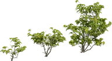</a> <b><a href="didelta_spinosa">Didelta Spinosa</a></b> by Jenelle van Heerden · <a href="https://polyhaven.com/a/didelta_spinosa">source</a> | <a href="dry_branches_medium_01">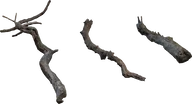</a> <b><a href="dry_branches_medium_01">Dry Branches Medium 01</a></b> by Rico Cilliers · <a href="https://polyhaven.com/a/dry_branches_medium_01">source</a> | <a href="dry_quiver_leaf">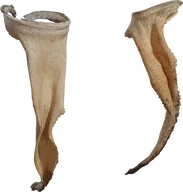</a> <b><a href="dry_quiver_leaf">Dry Quiver Leaf</a></b> by Greg Zaal, Rico Cilliers · <a href="https://polyhaven.com/a/dry_quiver_leaf">source</a> |
| <a href="fern_02">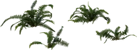</a> <b><a href="fern_02">Fern 02</a></b> by Rico Cilliers, Rob Tuytel · <a href="https://polyhaven.com/a/fern_02">source</a> | <a href="fir_sapling">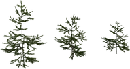</a> <b><a href="fir_sapling">Fir Sapling</a></b> by Rico Cilliers, Rob Tuytel · <a href="https://polyhaven.com/a/fir_sapling">source</a> | <a href="fir_sapling_medium">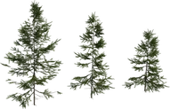</a> <b><a href="fir_sapling_medium">Fir Sapling Medium</a></b> by Rico Cilliers, Rob Tuytel · <a href="https://polyhaven.com/a/fir_sapling_medium">source</a> |  |

---

Kept up to date by this repository's own [update workflow](.github/workflows/update.yml), with code and plan from [cc0-mirror](https://github.com/zuujis-cc0/cc0-mirror). Something wrong? [Open an issue there](https://github.com/zuujis-cc0/cc0-mirror/issues/new) or use the [private report form](https://games.zuujis.com/report).
